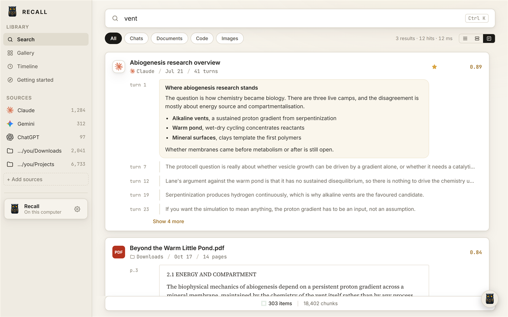

<p align="center">
  
</p>

<h1 align="center">Recall</h1>

<p align="center">
  Search your files and your Claude, ChatGPT and Gemini chats in one place, by what they say.<br>
  Runs on your computer. Nothing is uploaded.
</p>

<p align="center">
  <a href="https://github.com/ClehmanGit/recall/releases/latest/download/Recall-Setup.exe"><b>Download for Windows</b></a>
  &nbsp;·&nbsp;
  <a href="https://clehmangit.github.io/recall/">Website</a>
  &nbsp;·&nbsp;
  <a href="CHANGELOG.md">What's new</a>
</p>

<p align="center">
  
</p>

## What it does

You add the folders you care about and sign in to the chat apps you use. Recall reads them and keeps an index on your computer. Then you type what you remember, in your own words, and it finds the file or the chat and shows the passage that matches.

- **Search by meaning, not only exact words.** "the quote for redoing the kitchen" finds *Kitchen remodel quote.pdf* even if the PDF never uses the word "redoing". Exact words and file names work too.
- **Files and chats in one list.** One result per file or conversation, with its best passages and where they are: page 3, turn 12, line 44.
- **Stays current.** New and changed files are picked up as you save them. Chats are backed up every 15 minutes while Recall is running.
- **Leaves your files alone.** Recall never moves, changes or deletes them.

## Install

1. [Download Recall-Setup.exe](https://github.com/ClehmanGit/recall/releases/latest/download/Recall-Setup.exe) (Windows 10 or 11, 64-bit, about 34 MB).
2. Run it. It installs for your Windows account only, with no administrator prompt.
3. Windows may say it "protected your PC", because the installer is not code-signed yet. Click **More info**, then **Run anyway**.

To check that your download is the file GitHub built, compare its fingerprint with `SHA256SUMS.txt` on the [release page](https://github.com/ClehmanGit/recall/releases/latest):

```powershell
Get-FileHash .\Recall-Setup.exe -Algorithm SHA256
```

## Getting started

Recall opens with a short guide. In brief:

1. **Add folders.** Click **+ Add sources** and pick folders such as Documents or Downloads. Indexing starts right away. The computer works harder until it finishes, and search works the whole time.
2. **Connect chat apps (optional).** Under **+ Add sources**, pick Claude, ChatGPT or Gemini. A window opens on that app's own website. Sign in as usual, and Recall copies your chats: recent and starred ones first, older ones while the computer is idle.
3. **Search.** Press <kbd>Ctrl</kbd>+<kbd>K</kbd> from anywhere in Recall and type.

Click a result to open the file at the right page, or the chat in your browser. Closing the window keeps Recall running in the system tray so it stays current. To stop it, right-click the tray icon and choose **Quit Recall**.

### What it reads

| Kind | Files |
| --- | --- |
| Documents | PDF, Word (`.docx`), plain text, Markdown, CSV |
| Spreadsheets | Excel (`.xlsx`, `.xls`) |
| Code | Common source and config files: `.py`, `.js`, `.ts`, `.rs`, `.go`, `.java`, `.cs`, `.json`, `.yaml` and more |
| Pictures | PNG, JPG, GIF, WebP and more, found by file name |
| Chats | Claude, ChatGPT, Gemini |

By default Recall skips program folders, code projects, installers and archives, video and audio, and pictures named only by a camera or a number, such as `IMG_0412.jpg` or `Screenshot 2026-01-02.png`, since a picture is found by its name. Change this in **Settings › What to skip**. To drop a single result, hover over it and click **Hide**. **Settings › Hidden items** brings it back.

## Privacy

- **Nothing leaves your computer.** The index is stored in your Windows user folder. Recall has no account, no ads, no analytics and no telemetry. The official download makes no network requests of its own.
- **Recall never sees your passwords.** You sign in to Claude, ChatGPT and Gemini on their own websites, in a window Recall opens. Each window talks only to its own site, the way a browser would.
- **It reads only what you choose:** the folders you add and the chat apps you sign in to.
- **You can remove all of it.** See [Your data](#your-data).

How each of these is enforced is described in [How Recall works](docs/how-it-works.md#security-model).

## Your data

Recall keeps its index and settings in `%LOCALAPPDATA%\Recall`, and the chat sign-ins in `%LOCALAPPDATA%\app.recall.desktop`.

| To | Do this |
| --- | --- |
| See how much space it uses | **Settings › Storage** |
| Start the index over | **Settings › Storage › Rebuild index**. Your folders and settings are kept. |
| Stop copying one chat app | **Settings › Chat apps › Disconnect**. This signs you out of that app inside Recall. |
| Remove Recall and everything it stored | **Windows Settings › Apps › Installed apps › Recall › Uninstall**. This removes the index, settings and chat sign-ins too. Your own files are not touched. |

## Known limitations

- Windows only.
- Text inside pictures and scanned PDFs is not read yet. Pictures are found by name.
- Chat export files (the ZIP each chat app can email you) can't be imported yet. Use sign-in instead.
- The index on disk is not encrypted. It is as private as your Windows account.
- The installer is not code-signed, so Windows shows a warning the first time.

## Questions and problems

[Open an issue](https://github.com/ClehmanGit/recall/issues). Please leave out personal file names and chat text. To report a security problem privately, see [SECURITY.md](SECURITY.md).

## For developers

Recall is a [Tauri 2](https://tauri.app) app: a Rust engine (`core/`) with a TypeScript front end (`src/`). Search combines SQLite full-text search with a small embedding model ([bge-small-en-v1.5](https://huggingface.co/BAAI/bge-small-en-v1.5)) that runs on your computer.

- [Development](docs/development.md): building, testing and releasing
- [How Recall works](docs/how-it-works.md): indexing, search, chat backup and the security model

## License

[MIT](LICENSE)
